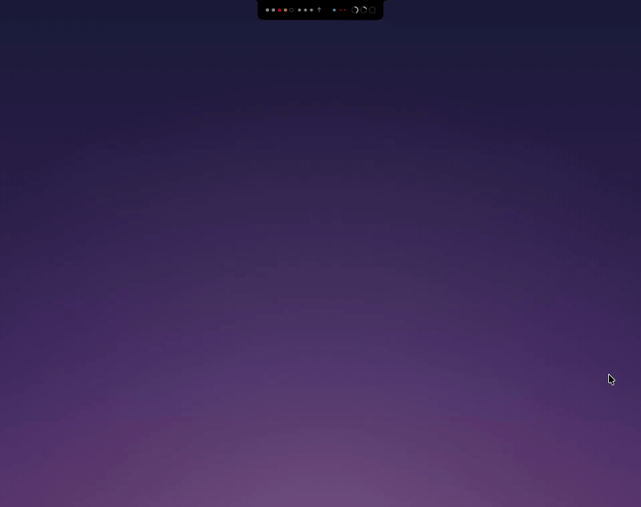
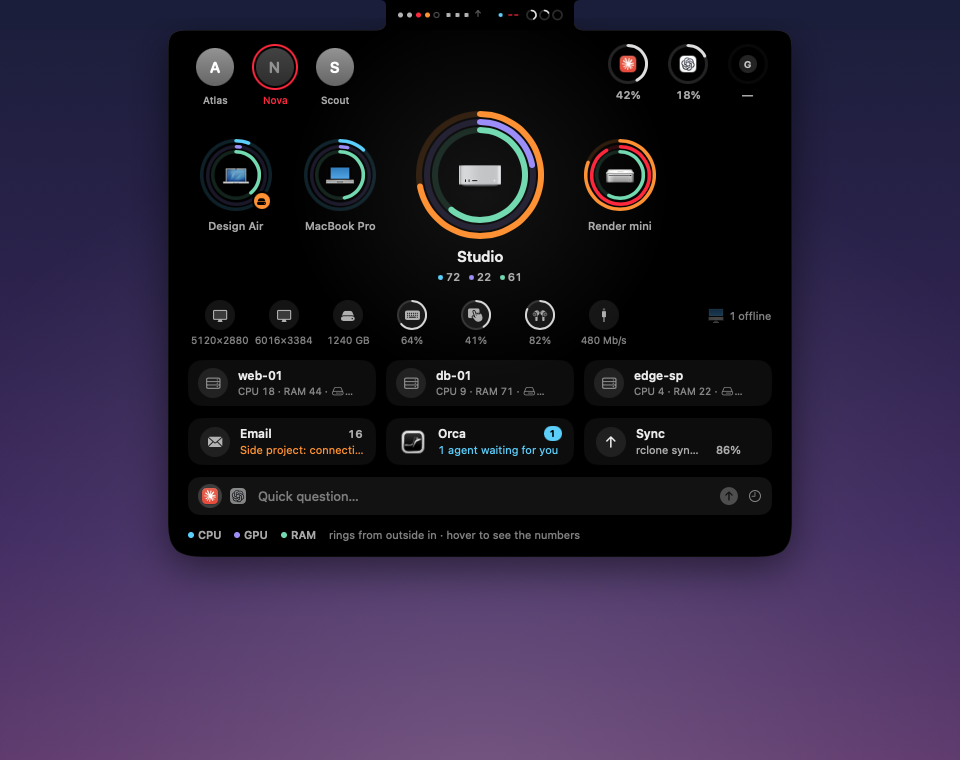
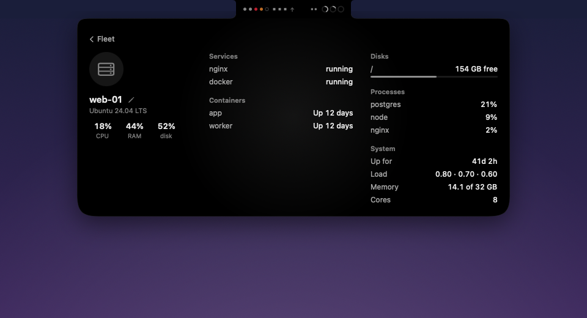
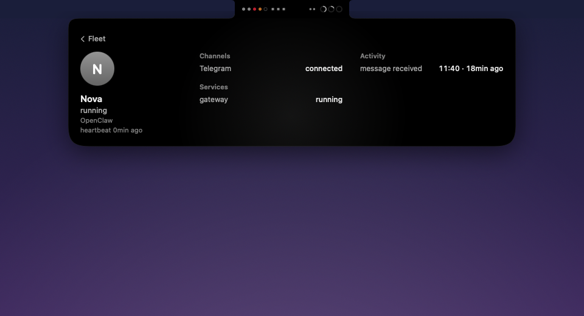
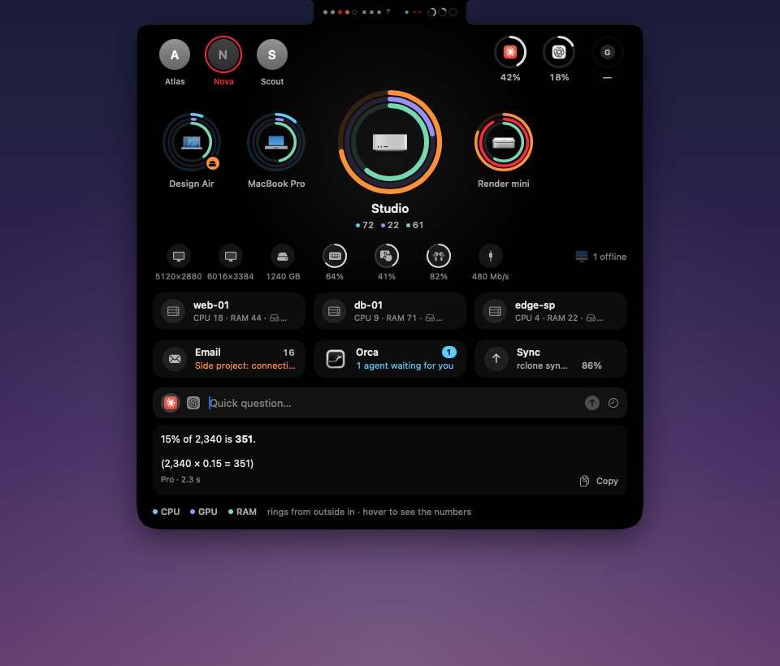
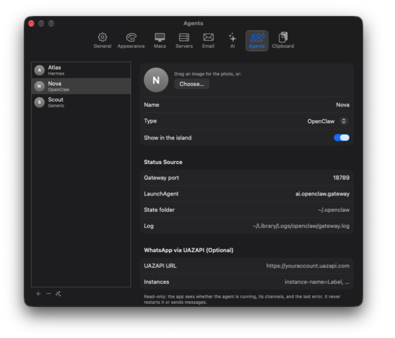
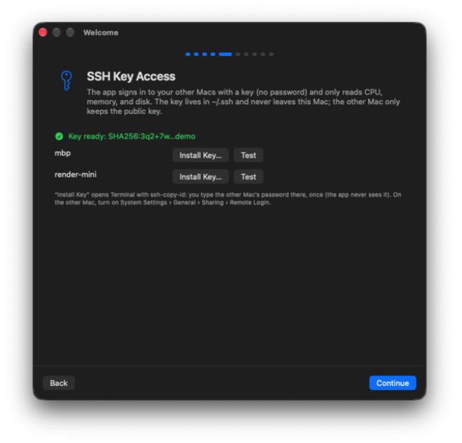
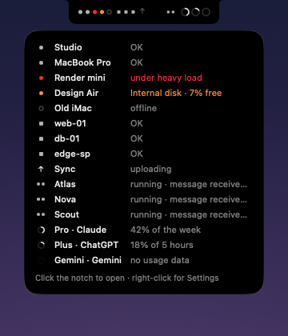
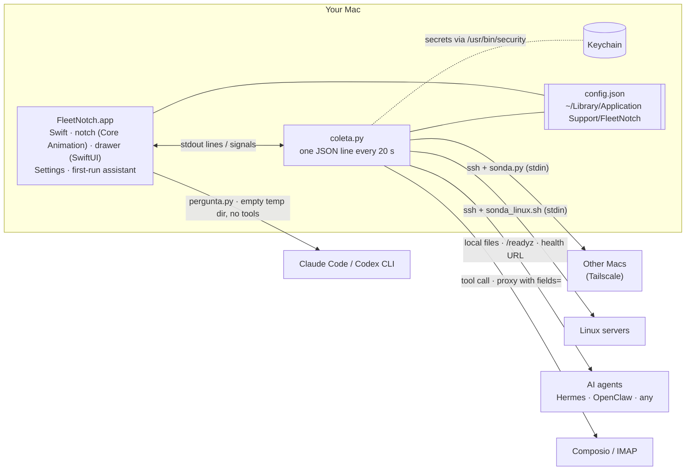

<div align="center">

# FleetNotch

### Your whole fleet, in the notch.

Every Mac, every server, every AI agent and AI subscription you run, at a glance from the top of your screen.<br>
Native macOS. Read-only. No server, no account, nothing installed on the machines it watches.

[](https://www.instagram.com/eduardocavalcanti/)<br>
**Built by [Edu Cavalcanti](https://www.instagram.com/eduardocavalcanti/).** I share how I run my companies with AI agents and a fleet of Macs: follow along on Instagram, [@eduardocavalcanti](https://www.instagram.com/eduardocavalcanti/).

[](#install)
[](#architecture)
[-3776AB?logo=python&logoColor=white)](#architecture)
[](LICENSE)
[](#privacy--security)
[](https://github.com/bisnishub/fleetnotch/actions)



<sub>Recorded in demo mode: every name, number and email above is made up.</sub>

[Português](README.pt-BR.md) · [Install](#install) · [Uninstall](#uninstall) · [Features](#features) · [Privacy](#privacy--security) · [Architecture](#architecture) · [Roadmap](#roadmap)

</div>

> **Painel Notch** is [Matheus Frota](https://github.com/mhrzfrota)'s fork of [FleetNotch](https://github.com/bisnishub/fleetnotch) by
> [Edu Cavalcanti](https://www.instagram.com/eduardocavalcanti/), for people who run their work from **one Mac**. On top of everything
> FleetNotch does, it adds four read-only cards (Settings › Agents › Type):
>
> | Type | What it watches | Turns amber / red when |
> |---|---|---|
> | `sites` | your websites (and, optionally, the last Vercel deploy of each) | a site is slow / down or a deploy failed |
> | `metaads` | today's spend, conversations and active campaigns of a Meta ad account | cost per conversation above your limit / no campaign running |
> | `git` | every repo in a folder: uncommitted changes and unpushed commits | work left unsaved for more than N days |
> | `foco` | the weekly-focus note of your notes vault (`Semana de: YYYY-MM-DD`) | the note is more than 7 days old |
>
> Tokens (Vercel, Meta) go to the Keychain from the Settings window, never to `config.json`. Example: [docs/config-mf-exemplo.json](docs/config-mf-exemplo.json),
> details in [docs/agents.md](docs/agents.md). Install exactly like FleetNotch: `git clone https://github.com/mhrzfrota/painel-notch && cd painel-notch && ./install.sh`.

---

Notch apps show your music. Monitoring apps show one Mac in a wall of graphs. FleetNotch answers the only question you
ask fifty times a day: **is everything I run OK right now?** One dot per machine in the notch. Amber or red only when
something needs you. Click, and the whole picture opens like a watch face.

## Features

### 1. Every Mac you own, without installing anything on them



- Finds your Macs on **Tailscale** and reads them over **SSH with a key**. A tiny probe goes in through stdin and leaves nothing behind.
- CPU, GPU and memory as Apple Watch–style rings, temperature (no sudo), memory pressure, disks, top processes.
- **Everything plugged in**: displays, external drives, USB and Thunderbolt, Bluetooth with battery levels, audio output.
- One-click **safe actions** with a preview and a two-click confirm: free caches that rebuild themselves, empty the Trash, eject a disk, restart an app.

### 2. Linux servers too



A POSIX `sh` probe (dash, bash and busybox) for your VPSs: CPU, RAM, disks, load, uptime, the **systemd services you pick**
and your **Docker containers** (restarting or unhealthy ones turn amber). Add a server straight from your `~/.ssh/config`.

### 3. AI agents and AI subscriptions, side by side



- **Pluggable agent status**: [Hermes Agent](docs/agents.md#hermes) (including each profile it serves), [OpenClaw](docs/agents.md#openclaw)
  (gateway `/readyz`), or **any agent with a health URL**. Pick a photo for each one; several agents become an AirDrop-style row.
- **AI subscription usage** as rings: Claude (Claude Code rate limits, through a [one-line statusline](#claude-ring)) and ChatGPT/Codex,
  with when each window resets.
- **Quick ask**: <kbd>⌃⌥Space</kbd>, type, <kbd>Return</kbd>. Answered by the **Claude Code or Codex CLI you are already signed in to**
  (no API key), in an empty temp folder, **with every tool disabled**. Or bring your own API key.



### 4. Email at a glance, never the body

Unread counts and the latest header (from, subject, time) for each account, through **Composio** (bring your key) or plain
**IMAP**. Connection problems surface before your automations break. The body is never requested.

### 5. Native settings and a first-run assistant

<table><tr>
<td></td>
<td></td>
</tr></table>

A real macOS Settings window (<kbd>⌘,</kbd>) for machines, servers, email, AI accounts, agents, modules and block order,
colors and alert thresholds. With no config, a first-run assistant discovers your Macs on Tailscale, explains and installs the
SSH key (you type the remote password in Terminal, once; the app never sees it) and walks you through the rest.

Hover the closed notch and every dot, square, arrow, eye and ring gets a name:



## Install

```sh
git clone https://github.com/bisnishub/fleetnotch && cd fleetnotch && ./install.sh
```

`install.sh` compiles with `swiftc` (Command Line Tools only, no Xcode project), installs `~/Applications/FleetNotch.app` and a LaunchAgent (opens at login). Run it again to update.
The app is built on your own Mac, so there is no download to notarize and Gatekeeper has nothing to block.
Try it with fake data first: **Settings › General › Demo data**.

**Speaks English, Português, Español and Français.** It follows your Mac's language, shows up in System Settings › General ›
Language & Region › Applications for a per-app choice, and Settings › General › Language switches it live.

**Requirements:** macOS 14+ and Apple's Command Line Tools (`xcode-select --install`; they bring `swiftc` and `/usr/bin/python3`).
Optional: Tailscale (to find your Macs), Remote Login on the Macs you want to see, a Composio key (email), Claude Code or Codex (quick ask).

### Claude ring

Claude Code hands its statusline your plan's usage (5-hour and weekly windows). `install.sh` copies a small statusline to
`~/.claude/fleetnotch-statusline.py` that saves only those percentages and reset times (no credential, no prompt) to
`~/.claude/deck-rate-limits.json`, where FleetNotch reads them. Turn it on in `~/.claude/settings.json`:

```json
"statusLine": {"type": "command", "command": "~/.claude/fleetnotch-statusline.py"}
```

Already have a statusline? Keep it: `"command": "~/.claude/fleetnotch-statusline.py ~/.claude/your-statusline.sh"` passes it the
same input. The ring fills after your next Claude Code message. ChatGPT/Codex needs nothing: its usage is read from the Codex sessions.

### Uninstall

```sh
launchctl bootout gui/$(id -u)/app.fleetnotch
rm -rf ~/Applications/FleetNotch.app ~/Library/LaunchAgents/app.fleetnotch.plist \
       ~/Library/Application\ Support/FleetNotch ~/Library/Caches/FleetNotch ~/Library/Logs/fleetnotch \
       ~/.claude/fleetnotch-statusline.py ~/.claude/deck-rate-limits.json
while security delete-generic-password -s FleetNotch >/dev/null 2>&1; do :; done   # keys saved in the Keychain
```

If you turned on the Claude ring, also remove the `statusLine` line from `~/.claude/settings.json`. Nothing was installed on
the Macs and servers you watched (only cleanup actions leave a log in `~/Library/Logs/fleetnotch` there).

## Privacy & security

- **No server, no telemetry, no account.** Everything runs on your Mac. The only network calls are the ones you configure:
  SSH to your machines, your agents' local health URLs, and (only if you add them) Composio, IMAP, UAZAPI, or an AI API.
- **Read-only by design.** The probes only read. Agents are never restarted or messaged. Actions on your Macs are a fixed,
  audited list, always with a preview and a second click, and logged to `~/Library/Logs/fleetnotch/acoes.log`.
- **Secrets live in the Keychain**, never in `config.json` and never on a command line (they go to `/usr/bin/security` through stdin).
- **SSH keys, not passwords.** The assistant can create `~/.ssh/id_ed25519`; installing it on another Mac happens in Terminal,
  where you type that Mac's password once.
- **Email: headers only.** Composio's ready-made Gmail tools return a slice of the body, so headers go through the proxy with a
  closed field list (`fields=`/`$select=`). The app shows the estimated monthly Composio calls before you choose an interval.
- **Quick ask in a sandbox**: empty temp folder, Claude Code with `--tools ""` and no MCP or user settings, Codex in a read-only
  sandbox with shell, exec, browser, apps and plugins disabled; 90 s timeout; the question goes through stdin.

Found a problem? See [SECURITY.md](SECURITY.md).

## Architecture



- **The app is a thin shell.** It draws whatever `coleta.py` prints (one JSON line per cycle) and only redraws when a new line arrives: about 0.02% of a core when idle. The collector itself uses about 0.1–0.2%, plus a one-second probe on each Mac every 20 s.
- **All logic is Python with the standard library only**, so it runs on the system Python and is testable in a terminal: `python3 coleta.py --uma`.
- Agents are adapters in [`agentes.py`](agentes.py); [docs/agents.md](docs/agents.md) shows how to add one. The config format is in [docs/config.md](docs/config.md).

## Roadmap

- [ ] More languages (see [i18n/README.md](i18n/README.md): one JSON file per language)
- [ ] Homebrew formula that builds from source (same as `install.sh`, nothing to notarize)
- [ ] Linux probe over SSH for Raspberry Pi and NAS boxes (ARM, BusyBox)
- [ ] More agent adapters (n8n, LangGraph servers, custom MCP servers)
- [ ] Notifications when something turns red
- [ ] Widgets (WidgetKit) with the same rings

## Contributing

Issues and pull requests are welcome. Read [CONTRIBUTING.md](CONTRIBUTING.md): tests run in a terminal (`python3 teste_coleta.py`,
`python3 teste_acoes.py`), the UI has an automated glitch test, and screenshots must come from **demo mode**, never your own data.

## License

[MIT](LICENSE) © 2026 Eduardo Cavalcanti
