<div align="center">

# FleetNotch

### Sua frota inteira, no notch.

Cada Mac, cada servidor, cada agente de IA e cada assinatura de IA que você usa, num relance, no topo da tela.<br>
macOS nativo. Só leitura. Sem servidor, sem conta, nada instalado nas máquinas que ele olha.

[](https://www.instagram.com/eduardocavalcanti/)<br>
**Feito pelo [Edu Cavalcanti](https://www.instagram.com/eduardocavalcanti/).** Mostro como eu toco minhas empresas com agentes de IA e uma frota de Macs: acompanha no Instagram, [@eduardocavalcanti](https://www.instagram.com/eduardocavalcanti/).

[](#instalar)
[](#arquitetura)
[-3776AB?logo=python&logoColor=white)](#arquitetura)
[](LICENSE)
[](#privacidade-e-segurança)

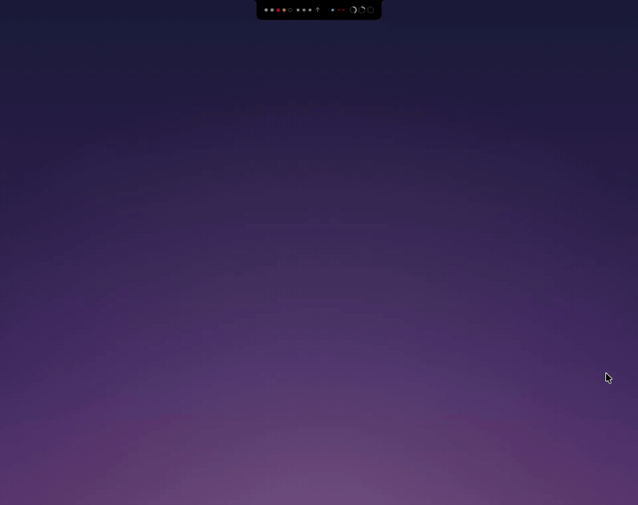

<sub>Gravado no modo demonstração: todo nome, número e e-mail acima é inventado.</sub>

[English](README.md) · [Instalar](#instalar) · [Desinstalar](#desinstalar) · [O que faz](#o-que-faz) · [Privacidade](#privacidade-e-segurança) · [Arquitetura](#arquitetura) · [Roadmap](#roadmap)

</div>

---

App de notch mostra a música. App de monitoramento mostra um Mac numa parede de gráficos. O FleetNotch responde a pergunta que
você faz cinquenta vezes por dia: **está tudo bem com o que eu tenho rodando?** Um ponto por máquina no notch. Âmbar ou vermelho
só quando alguma coisa precisa de você. Um clique e o quadro inteiro abre como um mostrador do Apple Watch.

## Novo na 0.3

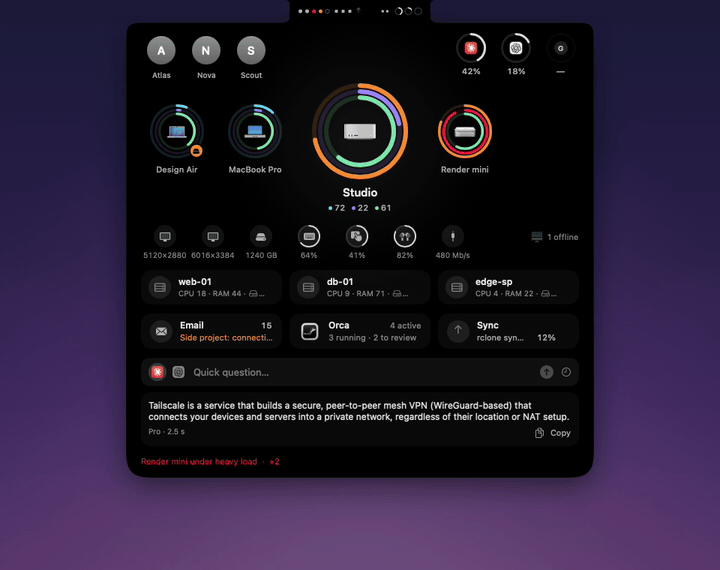

- **Light e Full.** Light é só ícones e anéis, os números aparecem no hover ou no clique; Full é tudo à vista. Escolhe nos Ajustes ou
  no assistente; a gaveta faz morph de um pro outro (com Reduzir movimento, um cross-fade curto).
- **Estilos dos anéis, como no Apple Watch.** Presets (Clássico, Atividade, Monocromático, Pastel, Neon, Grafite, Orgulho, Cor de cada IA)
  e um editor por anel: cor ou degradê, espessura, trilho, brilho, ponta arredondada, com prévia ao vivo. Salva os seus; volta ao padrão
  quando quiser. Âmbar e vermelho continuam valendo por cima de qualquer estilo.
- **Uso por modelo de cada conta de IA.** Clica no anel da conta: hoje, 7 dias ou mês, modelo por modelo (Fable, Opus, Sonnet, Haiku,
  GPT…), tokens de entrada, saída e cache, e o custo estimado por uma **tabela de preços local e editável**. Lido aos pouquinhos dos
  registros que o Claude Code e o Codex já gravam; nenhuma API chamada, nada sai do Mac, CPU zero parado.
- **Mais do seu jeito:** cor de destaque, densidade, o que os anéis do Mac mostram (CPU, GPU, RAM, disco, temperatura), números
  compactos ou completos, o notch fechado (todos os sinais, só alertas ou nenhum), abrir no hover, som e toque, e o atalho global à sua
  escolha. Tudo com "voltar ao padrão".
- **Painel na barra de menus** no mesmo desenho do notch: a frota numa frase, cada Mac como um mostradorzinho, as contas de IA, o que
  precisa de você e atalhos de teclado (<kbd>⌘O</kbd> ilha, <kbd>⌘,</kbd> Ajustes, <kbd>⌘Q</kbd> sair).
- **Histórico do que você copia (opcional, desligado de fábrica).** As últimas coisas copiadas (texto, link, imagem, arquivo) na gaveta;
  um clique copia de novo. Só na memória, limite e validade que você escolhe, "limpar histórico", e **nunca** guarda o que o macOS ou o
  gerenciador de senhas marcam como sensível (`org.nspasteboard.ConcealedType`, `TransientType`, `AutoGeneratedType`) nem nada dos apps
  excluídos (1Password, Acesso às Chaves e a sua lista). Nunca aparece no modo demonstração.

<table><tr>
<td>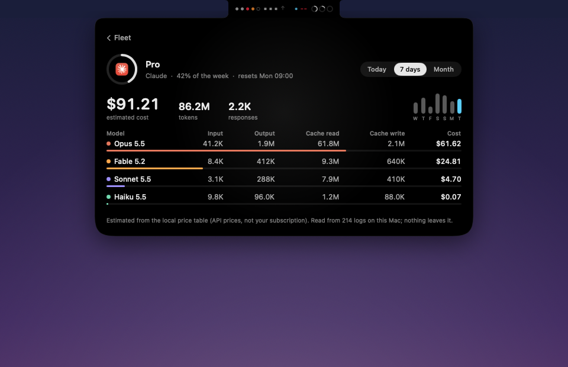</td>
<td>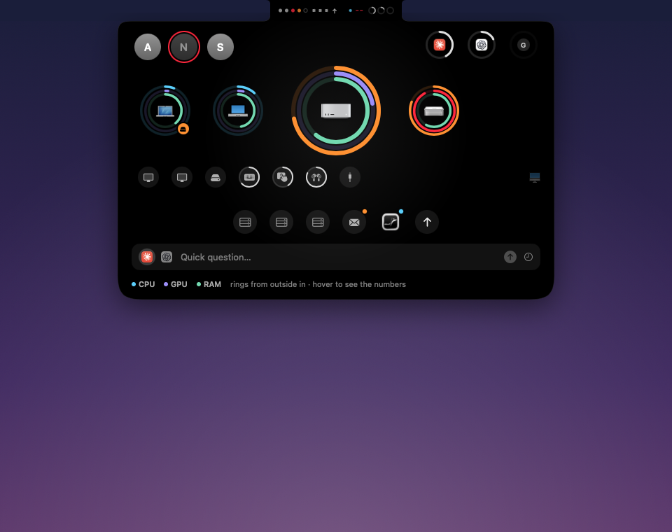</td>
</tr><tr>
<td>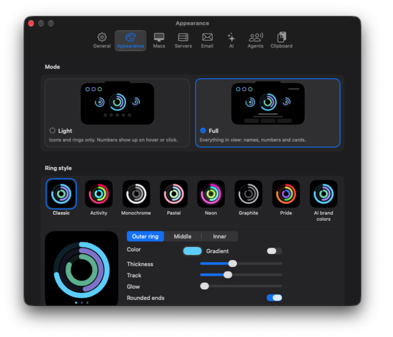</td>
<td>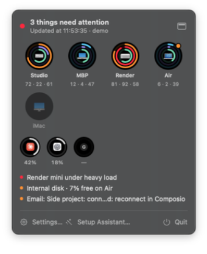</td>
</tr></table>

## O que faz

### 1. Todos os seus Macs, sem instalar nada neles

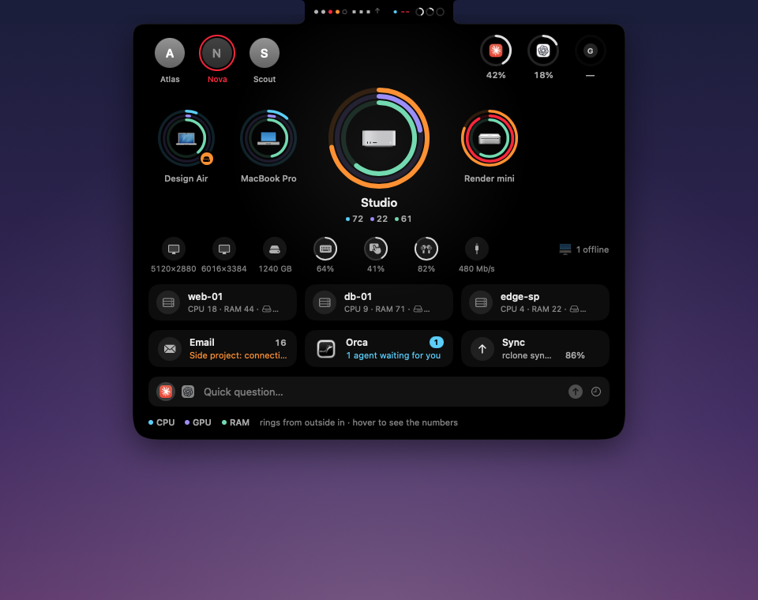

- Acha seus Macs na **Tailscale** e lê cada um por **SSH com chave**. Uma sonda pequena entra pelo stdin e não deixa nada lá.
- CPU, GPU e memória em anéis como os do Apple Watch, temperatura (sem sudo), pressão de memória, discos, processos.
- **Tudo que está plugado**: monitores, discos externos, USB e Thunderbolt, Bluetooth com bateria, saída de som.
- **Ações seguras** com prévia e confirmação em dois cliques: liberar cache que se refaz sozinho, esvaziar a Lixeira, ejetar disco, reiniciar um app.

### 2. Servidores Linux também

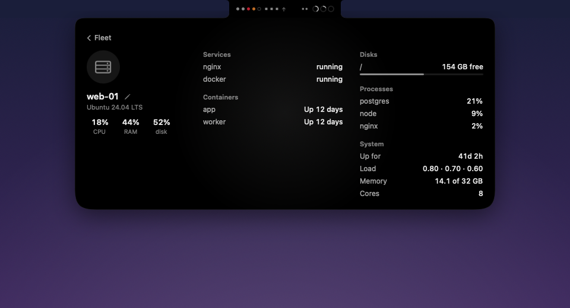

Uma sonda em `sh` POSIX (dash, bash e busybox) pros seus VPS: CPU, RAM, discos, carga, tempo ligado, os **serviços do systemd
que você escolher** e os **containers Docker** (reiniciando ou doente fica âmbar). Adiciona servidor direto do `~/.ssh/config`.

### 3. Agentes de IA e assinaturas de IA, lado a lado

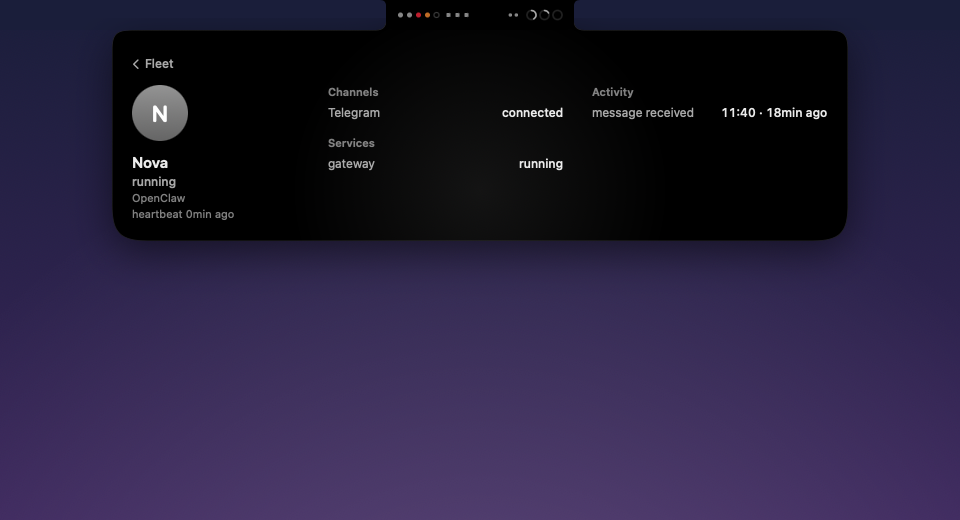

- **Status de agente plugável**: [Hermes Agent](docs/agents.md#hermes) (com cada perfil que ele serve), [OpenClaw](docs/agents.md#openclaw)
  (o `/readyz` do gateway) ou **qualquer agente com uma URL de health**. Escolha uma foto pra cada um; vários viram uma fileira como a do AirDrop.
- **Uso das assinaturas de IA** em anéis: Claude (limites do Claude Code, por um [statusline de uma linha](#anel-do-claude)) e
  ChatGPT/Codex, com quando cada janela volta.
- **Pergunta rápida**: <kbd>⌃⌥Espaço</kbd>, digita, <kbd>Enter</kbd>. Quem responde é o **Claude Code ou o Codex que você já usa logado**
  (sem chave de API), numa pasta temporária vazia, **com toda ferramenta desligada**. Ou traga sua chave de API.

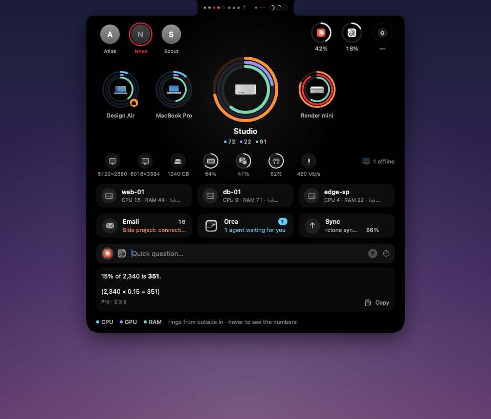

### 4. E-mail num relance, nunca o corpo

Quantos não lidos e o último cabeçalho (de, assunto, hora) de cada conta, pelo **Composio** (com a sua chave) ou por **IMAP**.
Conexão caída aparece antes de quebrar as suas automações. O corpo nunca é pedido.

### 5. Ajustes nativos e um assistente de primeira execução

<table><tr>
<td>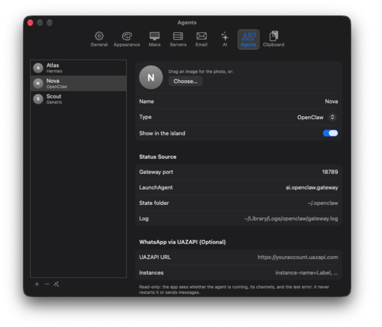</td>
<td>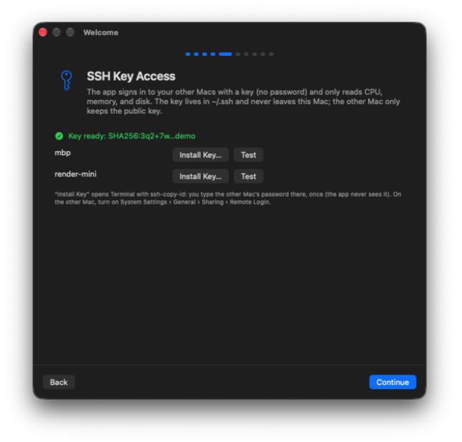</td>
</tr></table>

Uma janela de Ajustes de verdade (<kbd>⌘,</kbd>) pra máquinas, servidores, e-mail, contas de IA, agentes, módulos e ordem dos blocos,
cores e limites de alerta. Sem config, o assistente acha seus Macs na Tailscale, explica e instala a chave SSH (você digita a senha
do outro Mac no Terminal, uma vez; o app nunca vê a senha) e passa pelo resto.

Passe o mouse no notch fechado e cada ponto, quadradinho, seta, olho e anel ganha nome:

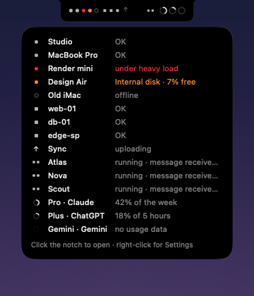

## Instalar

```sh
git clone https://github.com/bisnishub/fleetnotch && cd fleetnotch && ./install.sh
```

O `install.sh` compila com `swiftc` (só as Command Line Tools, sem projeto do Xcode), instala `~/Applications/FleetNotch.app` e um LaunchAgent (abre no login). Rodar de novo atualiza.
O app é compilado no seu próprio Mac: não há download pra notarizar e o Gatekeeper não tem o que bloquear.
Quer ver antes com dados de mentira? **Ajustes › Geral › Dados de demonstração**.

**Fala português, English, español e français.** Segue o idioma do Mac, aparece em Ajustes do Sistema › Geral › Idioma e
Região › Aplicativos pra escolher só pra ele, e Ajustes › Geral › Idioma troca na hora.

**Precisa de:** macOS 14+ e as Command Line Tools da Apple (`xcode-select --install`; elas trazem o `swiftc` e o `/usr/bin/python3`).
Opcional: Tailscale (pra achar seus Macs), Login Remoto ligado nos Macs que você quer ver, uma chave do Composio (e-mail), Claude Code ou
Codex (pergunta rápida).

### Anel do Claude

O Claude Code entrega ao statusline o uso do seu plano (janela de 5 horas e semanal). O `install.sh` copia um statusline pequeno
pra `~/.claude/fleetnotch-statusline.py` que guarda só esses percentuais e horários de reset (nenhuma credencial, nenhum prompt) em
`~/.claude/deck-rate-limits.json`, de onde o FleetNotch lê. Ligue no `~/.claude/settings.json` (enquanto não ligar, o `install.sh`
mostra a linha exata, já encadeada com o seu statusline atual se você tiver um):

```json
"statusLine": {"type": "command", "command": "~/.claude/fleetnotch-statusline.py"}
```

Já tem um statusline? Mantenha: `"command": "~/.claude/fleetnotch-statusline.py ~/.claude/seu-statusline.sh"` repassa a mesma
entrada pra ele. O anel enche depois da próxima mensagem no Claude Code. ChatGPT/Codex não precisa de nada: o uso vem das sessões do Codex.

### Desinstalar

```sh
launchctl bootout gui/$(id -u)/app.fleetnotch
rm -rf ~/Applications/FleetNotch.app ~/Library/LaunchAgents/app.fleetnotch.plist \
       ~/Library/Application\ Support/FleetNotch ~/Library/Caches/FleetNotch ~/Library/Logs/fleetnotch \
       ~/.claude/fleetnotch-statusline.py ~/.claude/deck-rate-limits.json
while security delete-generic-password -s FleetNotch >/dev/null 2>&1; do :; done   # chaves guardadas no Keychain
```

Se ligou o anel do Claude, tire também o `~/.claude/fleetnotch-statusline.py` do comando `statusLine` no
`~/.claude/settings.json` (apague a linha, ou deixe só o seu statusline se você encadeou um). Nada foi instalado nos Macs e servidores
que você acompanhava (só as ações de limpeza deixam um log em `~/Library/Logs/fleetnotch` neles).

## Privacidade e segurança

- **Sem servidor, sem telemetria, sem conta.** Tudo roda no seu Mac. As únicas chamadas de rede são as que você configura:
  SSH nas suas máquinas, as URLs de health locais dos agentes e (só se você adicionar) Composio, IMAP, UAZAPI ou uma API de IA.
- **Só leitura por desenho.** As sondas só leem. Agente nunca é reiniciado nem recebe mensagem. As ações nos Macs são uma lista
  fixa e auditada, sempre com prévia e segundo clique, registradas em `~/Library/Logs/fleetnotch/acoes.log`.
- **Segredo mora no Keychain**, nunca no `config.json` e nunca na linha de comando (vai pro `/usr/bin/security` pelo stdin).
- **Chave SSH, não senha.** O assistente cria a `~/.ssh/id_ed25519`; instalar no outro Mac acontece no Terminal, onde você digita a
  senha daquele Mac uma vez.
- **E-mail: só cabeçalho.** As ferramentas prontas de Gmail do Composio devolvem um pedaço do corpo; por isso o cabeçalho vem pelo
  proxy com a lista de campos fechada (`fields=`/`$select=`). O app mostra quantas chamadas por mês vão pro Composio antes de você
  escolher o intervalo.
- **Pergunta rápida isolada**: pasta temporária vazia; Claude Code com `--tools ""`, sem MCP e sem as configurações do usuário;
  Codex em sandbox só-leitura com shell, exec, navegador, apps e plugins desligados; tempo-limite de 90 s; a pergunta vai pelo stdin.

Achou um problema? Veja o [SECURITY.md](SECURITY.md).

## Arquitetura

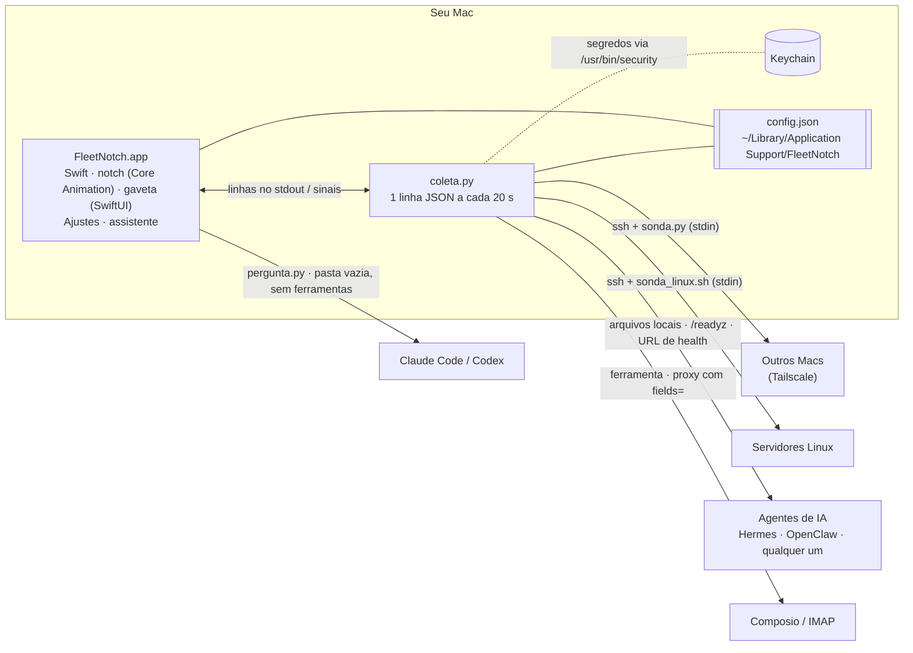

- **O app é uma casca fina.** Desenha o que o `coleta.py` imprime (uma linha JSON por ciclo) e só redesenha quando chega linha nova: uns 0,02% de um núcleo, parado. O coletor gasta uns 0,1–0,2%, mais uma sonda de 1 s em cada Mac a cada 20 s.
- **Toda a lógica é Python só com a biblioteca padrão**: roda no Python do sistema e dá pra testar no terminal: `python3 coleta.py --uma`.
- Agentes são adaptadores no [`agentes.py`](agentes.py); o [docs/agents.md](docs/agents.md) mostra como criar um. O formato da config está em [docs/config.md](docs/config.md).

## Roadmap

- [ ] Mais idiomas (ver [i18n/README.md](i18n/README.md): um arquivo JSON por idioma)
- [ ] Fórmula do Homebrew que compila do código (igual ao `install.sh`, nada pra notarizar)
- [ ] Sonda Linux pra Raspberry Pi e NAS (ARM, BusyBox)
- [ ] Mais adaptadores de agente (n8n, servidores LangGraph, servidores MCP próprios)
- [ ] Notificação quando algo fica vermelho
- [ ] Widgets (WidgetKit) com os mesmos anéis

## Contribuir

Issues e pull requests são bem-vindos. Leia o [CONTRIBUTING.md](CONTRIBUTING.md): os testes rodam no terminal (`python3 teste_coleta.py`,
`python3 teste_acoes.py`), a interface tem um teste automático de glitch, e print tem que sair do **modo demonstração**, nunca dos seus dados.

## Licença

[MIT](LICENSE) © 2026 Eduardo Cavalcanti
